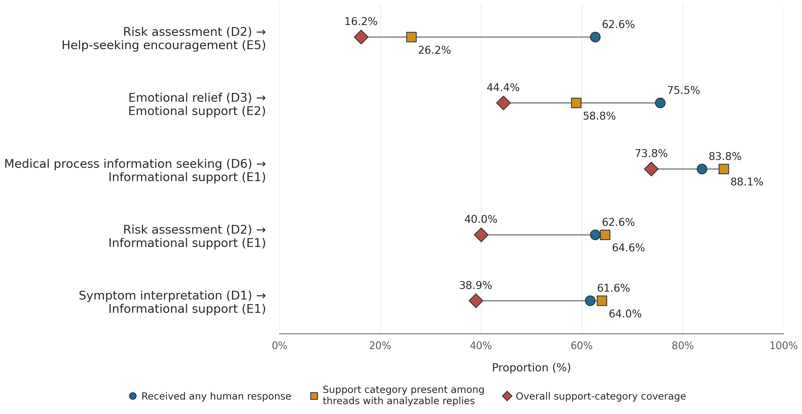
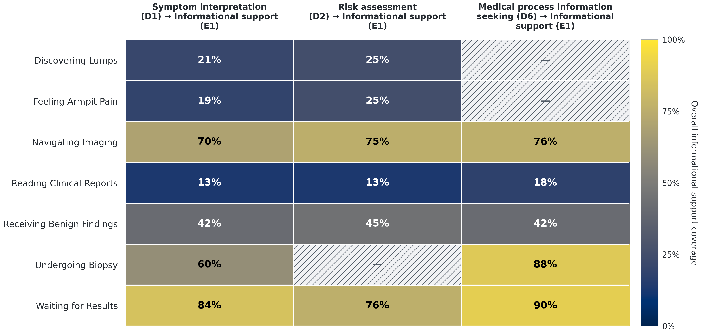

# breast-health-needs-and-support

**Repository description:** Statistical analysis code and coded data on expressed needs, peer support, and support-category coverage in an online breast health community.

This repository contains the actual coded analysis records and the statistical analysis used to examine expressed needs, receipt of human replies, and support-category coverage in an online breast health community. Its purpose is to make the coding-based statistical analyses transparent and reproducible.

The inputs are **real study coding data, not simulated examples**. Post/comment text, titles, usernames, URLs, original platform identifiers, the previous hashed identifiers, full timestamps, and coder notes have been excluded. The distributed research IDs are independently generated random values. No identifier crosswalk is included or saved in this package. Posting year and the within-topic sampling rank are retained because the sensitivity analyses use them.

The package starts **after topic assignment and final human coding**. It does not include corpus acquisition, raw Reddit text, LDA training, model/seed selection, independent recoding of text, or inter-rater reliability calculations. Frozen topic assignments are included as analytic context. The source-corpus topic-model summary in manuscript Table 1 and the manually prepared study-design figure are outside this package's reproduction scope.

## 1. Quick start

Python **3.12** was used to verify this package. Use a dedicated environment.

### macOS / Linux

```bash
python3 -m venv .venv
source .venv/bin/activate
python -m pip install -r requirements.txt
python run_all.py
```

### Windows PowerShell

```powershell
py -3.12 -m venv .venv
.venv\Scripts\Activate.ps1
python -m pip install -r requirements.txt
python run_all.py
```

If the computer already has a suitable Python environment, activate that environment and run the final two commands. Internet access is needed to install dependencies, but the analysis itself reads local files and makes no network requests. The 10,000-permutation tests and bootstrap procedures can take several minutes or longer, depending on the computer.

`run_all.py` performs four steps in order:

1. Validate the input schemas, codes, joins, and sample sizes.
2. Recalculate the complete coding-based statistical analysis.
3. Render manuscript Figures 2 and 3 from the new aggregate result tables.
4. Compare all 24 new aggregate tables with the archived reference results.

Run from the extracted repository directory. Paths are resolved relative to the scripts, so a particular username, home directory, or operating system path is not required. Running the scripts again replaces generated files inside `outputs/`; it does not modify the input CSVs or the reference tables.

## 2. Repository contents

```text
README.md                         Detailed English instructions
CODEBOOK.md                       Definitions and need–support mappings
FIGURE_ACCESSIBILITY.md            Submission palette, contrast checks, and suggested alt text
RIGHTS_AND_REUSE.md               License/reuse status and retained-data limitations
CITATION.cff                      Citation metadata, repository URL, and version
requirements.txt                  Direct package versions used for local verification
run_all.py                        Complete reproduction entry point
data/
  threads.csv                     1,000 coded thread records
  comments.csv                    2,532 coded eligible reply records
  topics.csv                      The 10 frozen topic labels
  data_dictionary.csv             Every distributed analysis field and its meaning
figures/                          Checked main-figure snapshots, data, alt text, and grayscale previews
src/
  validate_data.py                Input validation and documented count checks
  run_analysis.py                 Frozen statistical methods adapted to this layout
  render_figures.py               Manuscript Figures 2 and 3
  figure_style.py                 Shared submission palette and contrast-aware labels
  verify_results.py               Comparison with the 24 reference tables
reference_results/
  tables/                        Archived aggregate statistical tables
verification/
  preparation.json               Data preparation decisions without source identifiers
  release_verification.json      Completed local verification record
  file_manifest.csv              SHA-256 checksums of distributed files
.github/workflows/reproduce.yml   Optional automated reproduction when hosted on GitHub
.gitignore                       Excludes environments, caches, outputs, and private formats
.gitattributes                   Preserves text-file line endings across platforms
```

`outputs/` is created during a run and ignored by Git. It contains newly calculated tables, diagnostic plots, manuscript figure exports, and verification logs. It contains no exported row-level intermediate analysis table.

## 3. Data structure and joins

CSV files use UTF-8 encoding, comma separators, and a header row. Numeric codes are stored as numbers. Empty cells represent the documented missing/not-applicable values; an empty cell must not be silently converted to zero.

### `data/threads.csv`

One row represents an original post/thread in the 1,000-thread analytic sample. There are 100 selected threads in each of 10 topics. The sample contains the highest-topic-probability exemplars selected within each topic; it is not a probability sample of the whole community.

| Field(s) | Meaning and use |
|---|---|
| `thread_id` | A random research identifier beginning `T_`. It is not a Reddit ID or a hash of one. |
| `topic_id`, `topic_label` | Frozen topic assignment. IDs are 0–9; manuscript numbering is 1–10. Labels are in `topics.csv`. |
| `rank` | Sampling rank 1–100 within topic, with 1 being the highest topic probability. Used for the top-50 and top-75 sensitivity analyses. Topic probabilities are not included. |
| `year` | Posting year, 2022–2025. Used as a centered numeric term in the year-adjusted response-access model. No month, day, or timestamp is included. |
| `C1_interval` | Pathway position: 1 Appraisal, 2 Help-seeking, 3 Diagnostic work-up, 4 Pre-treatment, or blank for indeterminate/not applicable. |
| `C3_has_human_response` | Whether an eligible human reply was recorded, including an eligible reply whose content subsequently became unavailable. |
| A, B, and D fields | The 12 post-feature codes used in the reported analysis. Definitions and exact CSV column names are in the codebook and dictionary. |
| `actual_analyzable_comment` | Whether the thread has at least one retained analyzable eligible reply. |
| `n_analyzable_comments` | Number of retained reply records attached to this thread. |

Unused C2 and F follow-up variables from the internal coding workbook are not distributed. They are not inputs to the statistical analyses in this package.

### `data/comments.csv`

One row is one analyzable eligible first-level human reply. Automated replies and original-poster follow-ups are not comment-level units here.

| Field | Meaning |
|---|---|
| `comment_id` | Independent random research identifier beginning `C_`. No original comment number or identifier is retained. |
| `thread_id` | Foreign key to `threads.csv`. This is the only record linkage needed by the analysis. |
| `E1_informational` | Informational support present, 0/1. |
| `E2_emotional` | Emotional support present, 0/1. |
| `E5_help_seeking_encouragement` | Explicit encouragement to seek professional care, 0/1. |
| `E6_reassurance_normalization` | Reassurance/normalization present, 0/1. |
| `E7_experiential_information` | Information through comparable personal experience, 0/1. |

Support codes are nonexclusive. The script takes the maximum of each E code across a thread's retained comments, so a thread-level category is present when at least one analyzable reply contains that category.

### Example join

```python
import pandas as pd

threads = pd.read_csv("data/threads.csv")
comments = pd.read_csv("data/comments.csv")
e_columns = [name for name in comments.columns if name.startswith("E")]
support = comments.groupby("thread_id")[e_columns].max().reset_index()
joined = threads.merge(support, on="thread_id", how="left")
```

The join alone does not implement missing-content handling. `make_thread_e` in `run_analysis.py` additionally assigns zero support to unanswered threads and keeps support unknown for threads with a recorded response but no analyzable reply content.

## 4. Sample sizes and missing values

| Quantity | Count |
|---|---:|
| Threads in the coded sample | 1,000 |
| Threads with interpretable C1 position | 957 |
| C1 indeterminate/not applicable | 43 |
| Recorded human response, all threads | 730 |
| Threads with analyzable reply content | 719 |
| Recorded response but unavailable reply content | 11 |
| Retained comment-level coding records | 2,532 |
| Recorded human response in the 957-thread primary sample | 698 |
| Analyzable responding threads in that primary sample | 687 |

All 43 threads with indeterminate C1 remain in the input for documentation and validation. C1-based inference uses the other 957 threads.

The D2 risk-assessment field retains 34 source not-applicable/blank entries, including 2 within the primary C1 sample. These values have not been recoded during release preparation. In the frozen post-feature profiles, code sums omit missing values while the reported percentage denominator is the full C1 group. The corresponding chi-square crosstab omits missing outcome records. Need-specific analyses include only explicit D2 = 1 records. This documents the original implementation rather than silently changing its denominators.

### Human response and available content are different variables

For a thread with `C3_has_human_response = 0`, target support is treated as absent. For a thread with `C3_has_human_response = 1` but no retained analyzable reply, support content is unknown, not zero. The 11 such threads remain included in response-access analyses. They are excluded from the primary support-content denominators and included in extreme-case lower/upper bounds.

For each need–support mapping:

- **Response access:** need-expressing posts with a recorded human reply / all posts expressing that need.
- **Conditional category presence:** need-expressing posts with the target category / need-expressing posts with analyzable replies.
- **Overall identifiable coverage:** need-expressing posts with the target category / need-expressing posts whose support status is known, including unanswered posts.
- **Extreme-case bounds:** use all need-expressing posts; assign all unknown-content posts either no target category or the target category.

These are category-presence measures, not measures of medical accuracy, satisfaction, benefit, or clinical effectiveness.

## 5. Statistical methods implemented

- Counts, percentages, Wilson 95% confidence intervals, and medians/interquartile ranges.
- Global Pearson chi-square tests. If any expected cell count is <5, calculate the P value from 10,000 permutations of the outcome, using the Pearson statistic and the `(exceedances + 1) / (10000 + 1)` correction.
- Benjamini–Hochberg adjustment separately within 12 post-feature tests, five support-category tests, five mapping-coverage tests across C1 positions, and five mapping-coverage tests across topics within Diagnostic.
- Modified Poisson regression with HC3 robust standard errors for adjacent C1 comparisons; Holm adjustment across the three comparisons.
- Five core need–support mappings listed in `CODEBOOK.md`.
- 2,000 thread bootstrap resamples stratified by topic, restricted to the primary C1 sample, for percentile 95% coverage intervals.
- Exploratory Diagnostic-topic comparisons requiring at least 20 Diagnostic posts per topic and at least 10 expressing the relevant need for each mapping.
- A post hoc focused analysis of Reading Clinical Reports.
- Top-50/top-75 sampling-threshold sensitivity analyses, an analyzable-reply outcome definition, and adjustment for posting year.
- Post hoc equal-topic weighting for adjacent positions, requiring at least 10 posts in both positions within each included topic; 2,000 bootstrap resamples within topic-by-position groups for differences in response proportions.

The fixed analysis seed is `20260731`. A single random generator is used in the frozen execution order. Before analysis, thread rows are sorted by `topic_id` and `rank`, restoring the original analysis ordering without using source IDs. Keep the function call order and resampling counts unchanged for comparison with the reference tables.

The release adaptation changes identifiers, input/output paths, output-file organization, and execution messages. It does not change the statistical estimators or frozen data values. The previously exported row-level intermediate table has been disabled; aggregate results are sufficient outputs for this repository.

## 6. Results and verification

`reference_results/tables/` contains the 24 archived aggregate statistical tables. These serve as expected results, not as a substitute for recomputation.

After a complete run, inspect:

- `outputs/logs/input_validation.json`: input schema, joins, missing-content distinctions, and hard count checks.
- `outputs/logs/reference_comparison.json`: comparison of all 24 recomputed tables, with relative tolerance `1e-8` and absolute tolerance `1e-10` for numeric values.
- `outputs/tables/`: recalculated aggregate results.
- `outputs/manuscript_figures/`: manuscript Figure 2 (`figure2_support_gaps_publication.png`) and Figure 3 (`Figure3.png`).
- `outputs/figures/`: auxiliary plots from the original statistical script. Their numbering is internal and differs from manuscript numbering.

Central checks include 957 primary threads, 698 recorded responses, 687 analyzable responding threads, and 100 Reading Clinical Reports threads with 32 recorded replies and 13 threads containing informational support.

The versions in `requirements.txt` identify the environment used for this package's local verification. The original archival environment note listed different versions that were not a verified installation lock, so those unverified pins were not copied into this release. The verification record describes what was actually run. Floating-point or Monte Carlo differences can arise with different library versions or a changed execution order. Figure pixels and file hashes may differ by operating system or font while the underlying statistical tables agree.

To run one step separately:

```bash
python src/validate_data.py
python src/run_analysis.py
python src/render_figures.py
python src/verify_results.py
```

The GitHub workflow runs the same complete entry point under Python 3.12. It is supplied for future use; it has not been executed on GitHub during local preparation.

### Figure appearance and accessible alternatives

The main and auxiliary figures use the submission palette consistently: blue/circle for human response, gold/square for conditional support-category presence, red/diamond for overall coverage, and cividis for heatmaps. Numeric labels, dark marker outlines, contrast-aware heatmap text, and hatched ineligible cells supplement color. Figure exports include PNG, SVG, PDF, machine-readable plotted values, alt text, numerical contrast checks, and grayscale previews. See `FIGURE_ACCESSIBILITY.md` for descriptions, limits of these checks, and journal alt-text placement.

Checked snapshots are included in `figures/` so the plots can be inspected before running Python. The analysis writes new exports into `outputs/manuscript_figures/`. Full numeric precision is available in the adjacent CSV tables.





## 7. Privacy and interpretation limits

The package contains coded health-related research records. Direct platform identifiers and free text have been removed, and random research IDs do not encode original identifiers. Topic, rank, posting year, reply counts, and coding combinations remain. Their retention supports the requested analyses; it does not establish that re-identification is impossible. Do not use these records to identify or contact community members or to reconstruct their posts.

The sample was purposively selected with equal allocation to topics. Results describe this sampled topic mix and should not be interpreted as population prevalence. C1 describes the position at posting; the analysis does not observe within-person transitions or estimate causal stage effects. Support coverage does not establish whether a need was satisfied.

Rights and reuse terms are documented in `RIGHTS_AND_REUSE.md`. Repository: [https://github.com/KitePretty/breast-health-needs-and-support](https://github.com/KitePretty/breast-health-needs-and-support). This package is version **1.1.0**; no DOI has been assigned. Use a fixed release when citing or reproducing a specific version.
